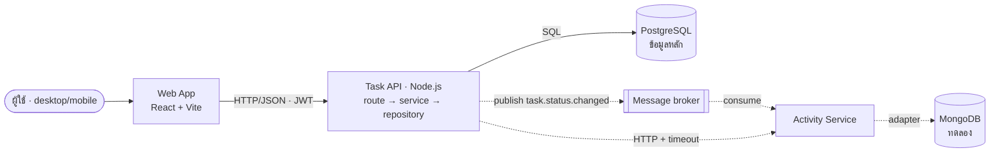

# Term Project · ระบบจัดการงานทีม (Task Board)

> **ENGSE207 สถาปัตยกรรมซอฟต์แวร์** · ภาคการศึกษาที่ 2/2569 · งานกลุ่ม 40 คะแนน (A5–A8) + หลักฐานรายคน (A1, A9)

[← หน้าหลักรายวิชา](../README.md) · [S01 · T01](../weeks/week01/README.md)

---

## แนวคิด

ทุกทีมใช้ระบบ Task Board ที่ผู้สอนเตรียมเป็นกรณีศึกษาต่อเนื่องทั้งเทอม ได้รับ brief ตั้งแต่ T01 รันครั้งแรกใน T02 แล้วต่อยอดทีละส่วนในแต่ละครั้งสอน ไม่เริ่มโปรเจกต์ใหม่หลายชุด

เป้าหมายไม่ใช่การสร้างระบบให้ใหญ่ที่สุด แต่คือการอ่านระบบได้ ตัดสินใจอย่างมีเหตุผล อธิบายแบบให้ตรงกับโค้ดและการติดตั้ง และประเมินด้วยหลักฐาน

## สถาปัตยกรรมปลายทาง



เส้นทึบคือส่วนหลักที่ส่งมอบใน ARCH-04 เส้นประคือส่วนทดลอง (T09–T11) ซึ่งไม่บังคับรวมในระบบส่งมอบสุดท้าย

> **ระบบสุดท้ายเป็น modular monolith ได้ ถ้าให้เหตุผลได้** การมี microservices หรือหลายฐานข้อมูลไม่ใช่เงื่อนไขของคะแนนสูง สิ่งที่วัดคือเหตุผลและหลักฐาน

## ทีม

- ทีมละประมาณ **3–4 คน** อยู่ทีมเดิมตลอดเทอม
- ทุกทีมต้องมีเครื่องที่รัน Docker ได้อย่างน้อย 2 เครื่อง
- ลงทะเบียนทีมที่[หน้าลงทะเบียน](https://se-rmutl.github.io/engse207/register.html) ได้รหัสทีม เช่น `S1-T03`
- ทำ team charter ให้เสร็จก่อน T02 ที่ `docs/team-charter.md` ใน repo ทีม (แม่แบบอยู่ที่ `templates/team-charter.md` ของ repo ทีม)
- **บทบาทรายครั้งสอน:** หมุนกันเป็น อ่านโค้ด → ลงมือ → ตรวจ ทุกคนต้องได้ลงมือ
- **บทบาทรายช่วง:** repo maintainer · เจ้าของเอกสาร ARCH · deploy owner (ตั้งแต่ T08) หมุนทุกช่วง
- บันทึกการหมุนบทบาทและงานของแต่ละคน ใช้เป็นหลักฐานของ A9

## กติกา Git ของทีม

- repo ของทีมสร้างจากแม่แบบ [`se-rmutl/engse207-team-template`](https://github.com/se-rmutl/engse207-team-template) ชื่อ `engse207-2569-s<SEC>-<ชื่อทีมภาษาอังกฤษ>` เช่น `engse207-2569-s1-cloudcats` เป็น private และเพิ่ม `tkeatkaew` เป็น collaborator ก่อนกรอกแบบลงทะเบียน
- ส่งงานโดย push ไฟล์ตาม path มาตรฐานเข้า `main` ระบบตรวจทุกชั่วโมง ดูกำหนดส่งและ path ทั้งหมดที่[หน้าสิ่งที่ต้องส่ง](https://se-rmutl.github.io/engse207/deliverables.html)
- `main` ต้องรันได้เสมอ งานใหม่ทำใน branch แล้วเปิด Pull Request ให้เพื่อนอีกคนรีวิวก่อน merge
- งานแต่ละชิ้นผูกกับ issue
- ห้าม commit ไฟล์ `.env` หรือ secrets ใช้ `.env.example` แทน
- ก่อนส่งงานให้ติด tag ของรุ่นที่ส่ง เช่น `t07-a5a`, `t14-submit` คะแนนแต่ละมิติใช้ snapshot ชุดเดียว

โครงสร้างของ repo ทีม (ชื่อไฟล์และโฟลเดอร์ต้องตรง เพราะใช้ตรวจการส่งอัตโนมัติ)

```text
<team-repo>/
├── README.md                 วิธีรันแบบ clean start และ Cloud URL
├── .env.example
├── docker-compose.yml
├── frontend/  backend/  …    ระบบ (ARCH-04)
├── docs/
│   ├── team-charter.md
│   ├── arch-01-context.md
│   ├── arch-02-diagrams/     ไฟล์ draw.io ต้นฉบับ + ภาพ
│   ├── arch-03-adr/          ADR-001-*.md, ADR-002-*.md, data-note.md
│   ├── arch-05-evaluation.md
│   ├── arch-06-handover.md
│   ├── labs/                 บันทึกแล็บ t02.md … t14.md
│   └── presentation/slides.pdf
├── individual/               งานเดี่ยว T01-<รหัส>.md, A1a-, A1b-, A2a-, A2b-, A9-log-, A9-reflection-<รหัส>.md
└── templates/                แม่แบบ คัดลอกไปใช้ตาม path
```

## ชุดผลงาน ARCH-01 ถึง ARCH-06

| รหัส | ขอบเขตขั้นต่ำ | เริ่ม / ปรับ | ประเมินใน |
|---|---|---|---|
| **ARCH-01** | บริบท ผู้ใช้ เป้าหมาย ขอบเขต ข้อจำกัด/ข้อสมมติ และ quality scenarios 2 เรื่อง | T03 → T07 | A5a |
| **ARCH-02** | C4 Context, Container, Deployment และ Dynamic/Sequence ของหนึ่ง flow · Component เฉพาะที่จำเป็น · มีไฟล์ที่แก้ได้ | T05 → T07 → T08 → T12 → T14 | A5a, A5b |
| **ARCH-03** | ADR ฉบับเต็ม 2 เรื่อง (การแบ่งโมดูล และการคงโมดูลหรือแยกบริการ) + บันทึกสั้นเรื่องข้อมูล 1 เรื่อง | T04 → T06 → T09 → T10 → T14 | A5b |
| **ARCH-04** | ระบบ React/Vite/JSX + Node + PostgreSQL รุ่น local และ Cloud · README/config · ผลทดลอง MongoDB และ event หนึ่ง flow | T02 → T04 → T08 → T09 → T11 → T14 | A6 |
| **ARCH-05** | สองสถานการณ์ เงื่อนไข วิธี ผลจริงเชิงตัวเลขอย่างน้อยหนึ่งเรื่อง ข้อจำกัด และการปรับหนึ่งจุด | T10 → T13 → T14 | A7 |
| **ARCH-06** | บทสรุปส่งต่อไทย/อังกฤษประมาณ 100–150 คำ ประวัติรุ่น แหล่งอ้างอิง peer review และงานที่ควรทำต่อ | T15 | A8, A9 (หลักฐาน) |

- ไม่แยกรายงานใหม่ 7 เล่ม และไม่ใช้จำนวนหน้าเป็นเกณฑ์คุณภาพ
- แต่ละคนชี้ลิงก์ส่วนที่ตนทำ และอธิบายได้เมื่อถูกซักถาม

## งานกลุ่มที่มีคะแนน

| รหัส | งาน | คะแนน | แบ่งมิติ | ส่ง |
|---|---|--:|---|---|
| A5 | ชุดเอกสารสถาปัตยกรรม | 15 | A5a: บริบท 3 + Context/Container 2 · A5b: ADR/ทางเลือก 6 + runtime/deployment/ความสอดคล้อง 4 | T07, T14 |
| A6 | ระบบและหลักฐานการนำขึ้นใช้งาน | 10 | ปรับและตรวจ local 3 · Cloud พร้อมการเชื่อมต่อและ persistence 4 · เริ่มซ้ำจาก README/config ที่ปลอดภัย 3 | สะสม T08–T14 |
| A7 | การประเมินและปรับปรุงสถาปัตยกรรม | 10 | สถานการณ์/วิธี 2 · ข้อมูลและคำนวณ 3 · ตีความข้อจำกัด 3 · ปรับและตรวจผล 2 | T13–T14 |
| A8 | นำเสนอและทบทวนร่วมกับเพื่อน | 5 | สื่อสารสอดคล้องกับระบบ 3 · ให้/รับ feedback และตอบเหตุผลร่วมกัน 2 | T15 |

## หลักฐานรายคนที่ต้องเก็บตลอดเทอม

- **A1 (T07, T14):** อธิบาย flow/แผนภาพ และแก้/ตรวจการทำงานด้วยตัวเอง พร้อม log/diff
- **A9 (สะสม T02–T15):** งานและบทบาทที่ตรวจได้ feedback ที่ให้และตอบสนอง แหล่งที่ตรวจหรือการใช้ AI (ถ้าใช้) และทักษะที่พัฒนา
- คะแนนทีมไม่ใช้แทนความสามารถรายคน · CLO4 ต้องมีส่วนร่วมบน Cloud ที่ซักถามได้ใน A1b พร้อมหลักฐาน A6

## ลำดับงานตลอดเทอม

| ครั้งสอน | งานของทีม |
|---|---|
| T01 | ติดตั้ง Docker · จัดทีม · team charter |
| T02 | รันระบบครั้งแรก · เริ่ม ARCH-04 |
| T03 | ARCH-01 รุ่นแรก |
| T04 | แบ่งโมดูลใน ARCH-04 · ฝึกเขียนเหตุผล ARCH-03 |
| T05 | ARCH-02 รุ่นแรก |
| T06 | ARCH-03 ADR ฉบับแรก |
| T07 | แลกตรวจ ARCH-01/02/03 · **A5a** |
| T08 | ระบบขึ้น Cloud (ARCH-04) · Deployment Diagram (ARCH-02) |
| T09 | ทดลอง MongoDB · บันทึกเรื่องข้อมูล (ARCH-03) |
| T10 | ADR ฉบับที่สอง · บันทึกผล failure (ARCH-05) |
| T11 | ผลทดลอง event หนึ่ง flow (ARCH-04/05) |
| T12 | ผลทดลองผู้ใช้มือถือ · ปรับแผนภาพ flow (ARCH-02/05) |
| T13 | ARCH-05 ฉบับร่าง |
| T14 | ปรับหนึ่งจุด · clean start · **A5b · A6 · A7** |
| T15 | นำเสนอ · ARCH-06 · **A8** |

[← หน้าหลักรายวิชา](../README.md)
